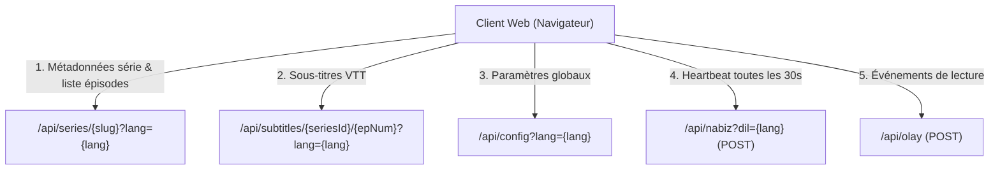
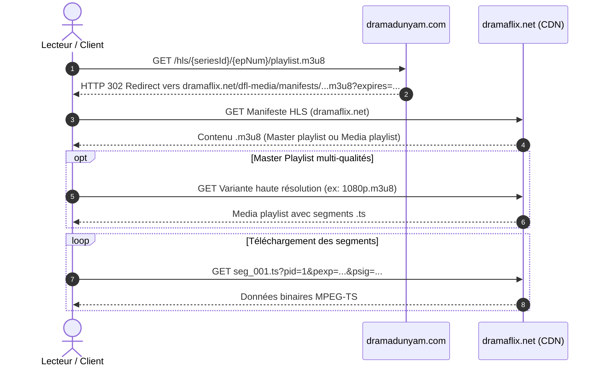
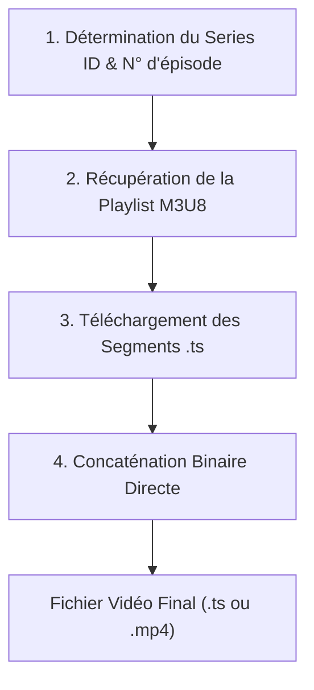

# 📊 Rapport d'Analyse FINAL — dramadunyam.com

> [!NOTE]
> Ce rapport documente l'architecture technique, le fonctionnement interne de la plateforme **dramadunyam.com**, ainsi que le pipeline complet de diffusion et de téléchargement de ses vidéos. Ce document se concentre exclusivement sur le fonctionnement natif du site et de ses serveurs de streaming.

---

## 1. Architecture Générale de la Plateforme

**dramadunyam.com** est une plateforme spécialisée dans le streaming de séries au format court ("mini-dramas" verticaux).

### Composants Technologiques
- **Framework Frontend** : **Next.js** (React avec rendu côté serveur / SSR et hydratation côté client).
- **Lecteur Vidéo** : Lecteur HTML5 natif orchestré par **hls.js** (`hls.min.js`), sans recours à une `<iframe>` externe.
- **Réseau & Sécurité Bordure** : Protégé par **Cloudflare** (CDN, gestion du cache, challenges anti-bot).
- **Infrastructure de Diffusion Vidéo** : Hébergée et distribuée via les serveurs CDN de **dramaflix.net** (`cdn.dramaflix.net`, `cdn2.dramaflix.net`).

---

## 2. Structure des URLs & Routage Multilingue

Le site applique un routage internationalisé où le code de langue préfixe la ressource.

| Type de Page | Format d'URL | Description |
|---|---|---|
| **Épisode (Anglais)** | `https://dramadunyam.com/en/series/{slug}/episode-{N}` | Ex: `/en/series/tangled-in-desire-3/episode-2` |
| **Épisode (Turc)** | `https://dramadunyam.com/dizi/{slug}/bolum-{N}` | Version turque (sans préfixe `/tr/`) |
| **Épisode (Allemand)** | `https://dramadunyam.com/de/serie/{slug}/folge-{N}` | Version allemande |
| **Épisode (Espagnol / Portugais)** | `https://dramadunyam.com/{es|pt}/serie/{slug}/episodio-{N}` | Versions hispanophone et lusophone |
| **Page Série (Index)** | `https://dramadunyam.com/{lang}/series/{slug}/` | Liste de tous les épisodes d'une œuvre |

### Hydratation des Données via `__NEXT_DATA__`
Puisque le site repose sur Next.js, chaque page contient une balise script JSON intégrée directement dans le DOM :
```html
<script id="__NEXT_DATA__" type="application/json">{ ... }</script>
```
Ce JSON contient l'état initial complet de la page (`props.pageProps`) :
- `props.pageProps.series.id` : L'identifiant numérique universel de la série (`seriesId`, 5 à 6 chiffres, ex. `229665`, `130631`, `125993`).
- `props.pageProps.series.title` : Titre complet et officiel de l'œuvre.
- `props.pageProps.series.episodes` : Liste des épisodes avec métadonnées (durées, titres, vignettes).
- `props.pageProps.series.cover` : Image de couverture pointant vers `/covers/{seriesId}.webp`.

---

## 3. Cartographie des APIs Internes (REST / JSON)

Le client communique avec plusieurs points de terminaison REST propres au domaine `dramadunyam.com` :



### 1. Métadonnées & Épisodes : `/api/series/{slug}?lang={lang}`
- **Méthode** : `GET`
- **Format retourné** : JSON
- **Données fournies** : 
  - `id` / `seriesId` : Identifiant numérique de la série.
  - `title` : Titre complet de la série.
  - `total_episodes` : Nombre total d'épisodes produits.
  - `episodes` : Tableau contenant chaque épisode avec son numéro d'ordre (`num`), son titre et sa vignette.

### 2. Sous-titres : `/api/subtitles/{seriesId}/{epNum}?lang={lang}`
- **Méthode** : `GET`
- **Format** : Fichier WebVTT (`.vtt`) ou structure JSON avec timetag et dialogues traduits.

### 3. Heartbeat & Télémétrie : `/api/nabiz` & `/api/olay`
- **`/api/nabiz?dil={lang}`** (`POST`) : Ping régulier (toutes les ~30 secondes) indiquant au serveur que la session de visionnage est active.
- **`/api/olay`** (`POST`) : Collecte les interactions utilisateur (clic sur lecture, pause, changement d'épisode, favoris).

---

## 4. Pipeline de Streaming & Lecteur Vidéo

### Absence de DRM Propriétaire
Les flux vidéo de **dramadunyam.com** **ne comportent aucun DRM matériel** (ni Google Widevine, ni Apple FairPlay, ni Microsoft PlayReady, ni ClearKey). Les vidéos ne sont pas chiffrées avec CENC (Common Encryption).

### Fonctionnement du Lecteur
1. La page instancie une balise HTML5 standard `<video>`.
2. Le script `hls.min.js` initialise l'API navigateur **MediaSource Extensions (MSE)**.
3. Une URL virtuelle `blob:https://dramadunyam.com/{uuid}` est assignée à l'attribut `src` de la balise vidéo.
4. `hls.js` télécharge les segments vidéo en arrière-plan, en extrait les paquets audio (AAC) et vidéo (H.264/AVC), et les injecte dans les tampons `SourceBuffer`.

---

## 5. Résolution des Flux Vidéo HLS (.m3u8)

La diffusion repose sur le protocole standard **HTTP Live Streaming (HLS)** :



### Étape 1 : Point d'entrée de la playlist
Pour chaque épisode, l'adresse de départ est normalisée :
```http
GET https://dramadunyam.com/hls/{seriesId}/{epNum}/playlist.m3u8
```
*Exemple réel :* `https://dramadunyam.com/hls/229665/2/playlist.m3u8`

### Étape 2 : Redirection vers le CDN
Le serveur `dramadunyam.com` ne sert pas lui-même les gros fichiers vidéo ; il répond par une redirection HTTP (302 Found ou 307 Temporary Redirect) vers l'infrastructure CDN :
```
https://dramaflix.net/dfl-media/manifests/shortwave/{hash}.m3u8?expires={timestamp}
```

### Étape 3 : Structure de la Playlist M3U8
Deux cas de figure se présentent selon les épisodes :
1. **Media Playlist directe** : Contient directement la liste chronologique des fragments `.ts`.
2. **Master Playlist (multi-qualités)** : Déclare plusieurs variantes de flux avec la balise `#EXT-X-STREAM-INF` :
   ```m3u8
   #EXTM3U
   #EXT-X-STREAM-INF:BANDWIDTH=2140000,RESOLUTION=1080x1920
   https://cdn2.dramaflix.net/.../1080p/playlist.m3u8
   #EXT-X-STREAM-INF:BANDWIDTH=1280000,RESOLUTION=720x1280
   https://cdn2.dramaflix.net/.../720p/playlist.m3u8
   ```

---

## 6. Sécurité des Médias, Tokens CDN & Expiration

La protection des flux repose sur un mécanisme de **signatures d'URL éphémères** :

### Anatomie d'une URL de segment
```
https://cdn2.dramaflix.net/media/DramaBox/EN/{slug}/ep_{N}_hls/seg_{NNN}.ts?pid=1&pexp=1790725800&psig=81a619cb...
```

| Paramètre | Fonction | Caractéristiques |
|---|---|---|
| **`pid`** | Platform ID | Identifiant interne du profil de diffusion (généralement `1`). |
| **`pexp`** | Timestamp d'expiration | Heure d'expiration Unix (en secondes). Validité typique : **~30 minutes**. |
| **`psig`** | Signature HMAC | Empreinte cryptographique calculée à partir de la clé secrète du CDN, du chemin du segment et de `pexp`. |

### Propriétés clés de cette sécurité :
1. **Tokens pré-calculés dans la playlist** : Toutes les URLs de segments listées dans le fichier `.m3u8` incluent déjà leur token `psig` individuel. Aucune requête d'authentification supplémentaire n'est requise par segment.
2. **Indépendance des cookies et des sessions** : Le CDN autorise le téléchargement dès lors que `psig` et `pexp` sont valides. Les cookies de session ne sont pas exigés pour récupérer les fragments `.ts`.
3. **Contrainte de péremption temporelle** : Comme les URLs expirent au bout de ~30 minutes, une playlist ne peut pas être mise en cache indéfiniment.

---

## 7. Réseau CDN & Mécanisme de Redondance (Failover)

Le service de streaming dispose d'un système de redondance à deux niveaux :

```
             ┌─────────────────────────────┐
             │       dramadunyam.com       │
             └──────────────┬──────────────┘
                            │ Redirection
                            ▼
           ┌────────────────────────────────┐
           │ CDN Principal : cdn2.dramaflix │
           └──────────────┬─────────────────┘
                          │ (En cas d'échec / timeout)
                          ▼
           ┌────────────────────────────────┐
           │ CDN Miroir    : cdn.dramaflix  │
           └────────────────────────────────┘
```

1. **Serveur principal** : `cdn2.dramaflix.net`
2. **Serveur miroir / fallback** : `cdn.dramaflix.net`

Les deux serveurs partagent la même arborescence et **acceptent les mêmes signatures `psig`**. Si un segment échoue sur `cdn2` (par exemple erreur HTTP 502/504 ou coupure réseau), une simple substitution de l'hôte vers `cdn.dramaflix.net` permet de poursuivre le flux sans interruption.

---

## 8. Fonctionnement du Téléchargement & Reconstitution Vidéo

Pour télécharger et reconstituer un épisode complet en dehors du navigateur, le processus s'effectue en 4 étapes séquentielles :



### 1. Récupération de la Playlist
On interroge l'URL :
```
GET https://dramadunyam.com/hls/{seriesId}/{epNum}/playlist.m3u8
```
En suivant la redirection vers `dramaflix.net`, on obtient le manifeste texte. Si plusieurs résolutions sont listées (`#EXT-X-STREAM-INF`), on sélectionne l'URL ayant le débit (`BANDWIDTH`) le plus élevé (1080p).

### 2. Téléchargement des Segments
Chaque segment listé dans la playlist (généralement 20 à 80 segments d'une durée de 2 à 4 secondes par épisode) est téléchargé sous forme de flux binaire brut (`application/octet-stream`).

> [!TIP]
> Il est recommandé d'effectuer les requêtes avec 2 connexions simultanées maximum afin d'éviter le déclenchement de règles de limitation de débit (rate limiting) sur le CDN.

### 3. Assemblage Binaire (MPEG-TS Concat)
Le format conteneur **MPEG-2 Transport Stream (`.ts`)** possède la propriété unique d'être un flux continu découpable en paquets autonomes de 188 octets.
Chaque paquet commence par un octet de synchronisation `0x47` et contient ses propres informations d'horodatage (PTS/DTS).

Par conséquent, **aucun réencodage ni outil lourd n'est nécessaire pour assembler la vidéo** : la simple concaténation binaire bout à bout des fichiers `seg_001.ts`, `seg_002.ts`, ..., `seg_NNN.ts` produit un fichier vidéo complet, valide et directement lisible par des lecteurs multimédias tels que VLC ou MPV :
```bash
# Exemple de fusion binaire (Linux / macOS) :
cat seg_*.ts > "Episode_Complet.ts"

# Exemple sous Windows (cmd) :
copy /b seg_001.ts + seg_002.ts + ... "Episode_Complet.ts"
```

### 4. Conversion Optionnelle en MP4
Pour obtenir un conteneur standard `.mp4` lisible sur tous les appareils sans réencoder la vidéo :
```bash
ffmpeg -i "Episode_Complet.ts" -c copy "Episode_Complet.mp4"
```
Cette opération s'exécute en quelques secondes car les flux élémentaires H.264 et AAC sont simplement remultiplexés sans altération de la qualité.

---

## 9. Synthèse des Points Critiques

| Aspect | Constat Technique |
|---|---|
| **Identifiant Série (`seriesId`)** | Toujours $\ge 1000$ (5 à 6 chiffres, ex. `229665`). Trouvable dans `__NEXT_DATA__`, les couvertures `/covers/{id}.webp`, ou `/api/series/{slug}`. |
| **Chiffrement / DRM** | **Aucun DRM.** Flux en clair au format standard H.264 / AAC dans des conteneurs MPEG-TS. |
| **Authentification CDN** | Assurée par les paramètres `psig` (HMAC SHA-256) et `pexp` (expiration ~30 min) intégrés dans les URLs. |
| **Redirection HLS** | Le point d'entrée `dramadunyam.com/hls/...` redirige vers `dramaflix.net`. Les requêtes CDN renvoient l'en-tête `Access-Control-Allow-Origin: *`. |
| **Haute Disponibilité** | Basculement transparent possible entre `cdn2.dramaflix.net` et `cdn.dramaflix.net`. |
